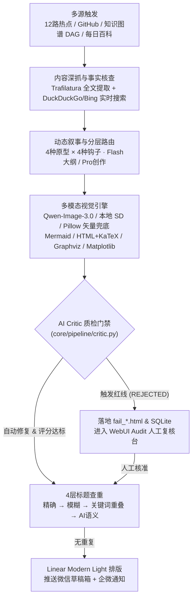

# AutoWeChat — 企业级 AI 微信公众号全流程创作与合规发布工作台

<p align="center">
  <strong>Human-in-the-Loop（人机协同）</strong> · <strong>4 大自动创作工作流</strong> · <strong>联网事实核查与 AI Critic 门禁</strong> · <strong>Linear Modern Light 双语控制台</strong>
</p>

<p align="center">
  <a href="README_EN.md">English</a> ·
  <a href="#核心创作工作流">四大工作流</a> ·
  <a href="#系统架构与质量闭环">架构与闭环</a> ·
  <a href="#webui-五维控制台">WebUI 控制台</a> ·
  <a href="#快速开始">快速开始</a> ·
  <a href="DEVELOPMENT.md">开发指南</a>
</p>

---

**AutoWeChat** 是一个面向技术媒体、垂直自媒体与专业内容团队的微信公众号自动化生产工作台。它打通了从**多源热点/知识图谱发现 -> 网页深抓与联网事实核查 -> 动态叙事撰写 -> AI 配图与多模态图表渲染 -> Critic 自动质检与人工审稿 -> 微信草稿箱去重推送**的全链路。

> [!IMPORTANT]
> **合规与安全底线**：系统所有自动发布任务仅推送至微信公众号**草稿箱（Draft Box）**，配合内置的 **Audit 审稿工作台** 实现人工终审把关，严禁绕过平台审核机制进行全自动无监督群发。

---

## 目录

- [核心创作工作流](#核心创作工作流)
- [系统架构与质量闭环](#系统架构与质量闭环)
- [核心工程特性](#核心工程特性)
- [WebUI 五维控制台](#webui-五维控制台)
- [项目目录结构](#项目目录结构)
- [快速开始](#快速开始)
- [环境变量参考](#环境变量参考)
- [云端部署与自动化调度](#云端部署与自动化调度)
- [测试与扩展文档](#测试与扩展文档)

---

## 核心创作工作流

系统提供统一的引擎入口（[`core/engine.py`](core/engine.py) 与 [`main.py`](main.py)），支持 CLI 命令行、APScheduler 定时调度以及 WebUI 一键触发以下 4 类创作流水线：

| 工作流标识 (`--task`) | 控制台页签 | 适用场景 | 核心驱动机制 |
| :--- | :--- | :--- | :--- |
| **`hotspots`** | 综合热点 | 科技、财经、时事深度解读 | 12 路信息源采集 + 领域关键词初筛 + `trafilatura` 全文深抓 + DuckDuckGo/Bing 实时事实搜索 + 4 类动态叙事原型切换 |
| **`github`** | 开源项目 | GitHub Trending 与高潜开源工具拆解 | GitHub Trending 网页抓取 + API 搜索（支持可选 `GITHUB_TOKEN` 提速）+ 仓库深度分析 + 架构图/配图自动合成 |
| **`aikepu`** | 硬核科普 | 垂直行业体系化长文连载 | 基于知识图谱 DAG（内置 5 套垂直领域图谱）按前置依赖解锁节点；Outline（大纲）→ Prompt 优化 → `ThreadPoolExecutor` 至多 4 个 Sub-Agent 并行成文 |
| **`daily_knowledge`** | 每日百科 | 轻量高频日常科普与百科日更 | [`daily_knowledge/`](daily_knowledge) 独立引擎，自动选题规划 + 历史去重 + 独立 SQLite 记录 + 轻量图文流水线 |

---

## 系统架构与质量闭环



---

## 核心工程特性

### 1. 联网事实核查与动态叙事引擎 (`Fact Grounding & Narrative`)
- **原文深抓与联网核查**：[`core/hotspots/scraper.py`](core/hotspots/scraper.py) 通过 `trafilatura` 与浏览器伪装请求提取原始信源正文；[`core/hotspots/searcher.py`](core/hotspots/searcher.py) 在开启 `ENABLE_FACT_SEARCH` 时自动执行 DuckDuckGo（HTML/Lite 双路降级）与 Bing 网页搜索，抽取权威时间线与事实摘要（默认最多 `MAX_FACT_SNIPPETS=4` 条）注入写作上下文，抑制模型幻觉。
- **动态叙事策略**：[`core/hotspots/narrative.py`](core/hotspots/narrative.py) 内置 4 种写作原型（`investigative_game` 深度调查博弈、`tech_deep_dive` 技术硬核拆解、`business_war` 商业竞争分析、`narrative_human` 人物纪实叙事）与 4 种黄金开篇钩子（`counter_intuitive`、`cost_and_bill`、`critical_scene`、`cognitive_reversal`），配合 `core/hotspots/processor.py` 消除千篇一律的“八股文”。

### 2. AI Critic 自动质检门禁与 HITL 审稿闭环
- **自动修复与质检**：[`core/pipeline/critic.py`](core/pipeline/critic.py) 在发文前执行四项自动化检查：
  1. 清洗高频“AI 味”套话短语（自动替换/删除）。
  2. 为缺失小节结构的长文自动补齐 H2 标题分节。
  3. 校验正文汉字规模、标题长度上限与禁用结尾标点。
  4. 综合评分与拦截：未通过门禁的文章状态标记为 `REJECTED`，预览 HTML 落地至 `data/previews/` 并写入本地 SQLite（[`data/auto_publish.sqlite`](core/db/manager.py)，WAL 模式），等待人类编辑审核。
- **人工终审直推**：审稿人可在 WebUI `审稿 (Audit)` 视图中预览完整排版、编辑或核准放行（`/api/review/approve`），核准后自动补传封面并同步至微信草稿箱。

### 3. 100% AI 生图与 5 模专业技术图表引擎
- **封面与正文配图 (`utils/image_handler.py`)**：已全面切换为纯 AI 生成架构（已禁用热点场景下的 Bing 爬虫抓取）：
  1. **首选**：通义万相 `Qwen-Image-3.0`（默认 `1280*720`，内置全局最小请求间隔与最大并发数限流保护）；Image Studio 二次重绘默认采用 `qwen-image-3.0-pro`。
  2. **备选**：本地 `Stable Diffusion WebUI` API（`SD_ENABLED` / `SD_API_URL`）。
  3. **兜底**：本地 Pillow 生成高对比 **Linear Modern Light** 风格矢量封面与摘要卡片，保证零外部依赖下链路不断档。
- **多模态技术图表与公式渲染 (`utils/diagram_gen.py`)**：支持并行渲染（默认 `DIAGRAM_PARALLEL_WORKERS=5`），自动处理微信富文本对透明 PNG 背景的黑底兼容性问题：
  - **高保真模态**：`Mermaid`（`mermaid.ink` 在线渲染 + 本地 [`utils/html_render.py`](utils/html_render.py) Selenium 无头浏览器降级）、`HTML + Tailwind + KaTeX`（复杂数学公式与高定信息卡片）。
  - **轻量兜底模态**：`Graphviz DOT`（[`utils/lite_render.py`](utils/lite_render.py)）与 `Matplotlib` 结构体卡片（公式卡、对比卡、总结卡），统一采用 Linear Modern Light（`#FFFFFF` / `#F8F9FB` / `#4F5BD5`）浅色专业配色。

### 4. 四层微信公众号标题防重机制 (`core/shared/publisher.py`)
发文前自动拉取**微信云端草稿箱 + 公众号已发布列表 + 本地发布历史**，按耗时由低到高依次执行 4 层校验：
1. **精确字符串匹配**（归一化大小写与空白符）。
2. **字符级模糊相似度**（`rapidfuzz` / `SequenceMatcher` 超过 `TITLE_DUPLICATE_RATIO` 阈值）。
3. **关键词 n-gram 重叠率**（重叠度 `>= 0.70` 拦截）。
4. **AI 语义查重兜底**（前三层均未命中时调用轻量 LLM 判断核心议题是否撞车）。

### 5. 5 套垂直知识包与“零访谈”账号定制工具链
- **开箱即用知识图谱**：[`data/knowledge_trees/`](data/knowledge_trees) 内置 `aikepu.json`（AI 硬核科普 30 节点）、`career.json`（职场成长 10 节点）、`health.json`（健康科普 8 节点）、`law.json`（法律实务 10 节点）与 `tax.json`（财税实务 6 节点），配合 `prompts/` 下对应的专属写作规范（如 `law_skill.md`、`tax_skill.md`）。
- **零访谈风格克隆 (`tools/`)**：
  - [`tools/analyze_account.py`](tools/analyze_account.py)：自动采集目标账号/行业历史标杆文章并提炼结构、语气与排版风格，生成专属 Writing Skill Prompt。
  - [`tools/build_knowledge_tree.py`](tools/build_knowledge_tree.py)：自动规划多阶梯知识图谱 DAG 并通过 `_active.txt` 热切换生效领域。

### 6. 多 Key 线程安全轮换与 Prompt Cache 遥测
- [`utils/key_pool.py`](utils/key_pool.py) 支持通过 `LLM_API_KEYS`、`DASHSCOPE_API_KEYS`（逗号分隔多组 Key）实现线程安全轮换（Round-Robin）与限流/异常自动冷却切换（429 冷却 120s、认证类 300s）。
- [`core/shared/llm.py`](core/shared/llm.py) 按任务难度自动路由 `Flash` / `Pro` 模型，并在控制台实时上报 Prompt Cache 命中率、节省 Token 数与节省金额（CNY）。

---

## WebUI 五维控制台

全新重构的 **Linear Modern Light** 控制台基于零构建（Zero-Build）原生 ES Module（[`static/js/main.js`](static/js/main.js)）与三层设计令牌样式（[`tokens.css`](static/css/tokens.css) / [`components.css`](static/css/components.css) / [`views.css`](static/css/views.css)），摒弃重型 WebGL 背景，以 4 层纯 CSS 微光网格画布实现桌面端与移动端底栏双端流畅适配，内置**中/英双语即时切换**与可选 `WEBUI_TOKEN` 鉴权登录页（[`templates/login.html`](templates/login.html)）。

| 视图标识 | 页面名称 | 核心能力说明 |
| :--- | :--- | :--- |
| **`console`** | 总控 (Console) | 4 类工作流一键切换、启动/暂停/恢复/强停、缓存预热、Prompt Cache 遥测条、4 阶段 Pipeline 进度条、Timeline 手风琴日志 / Raw 日志流、知识图谱进度卡与 Live Pulse |
| **`graph`** | 图谱 (Graph) | 知识图谱 DAG 拓扑浏览、1-4 阶梯筛选、垂直领域主题包热切换、自定义图谱 JSON 导入、微信已发记录同步、节点抽屉单篇“立即撰写”与状态标记 |
| **`audit`** | 审稿 (Audit) | HITL 质量门禁工作台（全部 / 待核准 / 已通过 / 待推送 / 已推送）、移动端感官级 HTML 全文预览、一键核准并同步微信草稿箱、历史条目批量清理 |
| **`image`** | 配图 (Studio) | 输入微信文章 URL 自动解析并执行合规重构重绘（`Qwen-Image-3.0-Pro`）、Markdown 配图指令自动提取、本地图片拖拽上传与 1:1 手机端微信排版预览 |
| **`ops`** | 运维 (Ops) | 包含 3 个运维子面板：**信源矩阵**（12 路热点源实时连通性探针）、**定时任务**（4 类工作流 APScheduler Cron 可视化配置）、**系统配置**（API Key、模型路由、图表并发数、SD 开关热更新） |

---

## 项目目录结构

```text
wechat_auto_publish/
├── main.py                        # CLI 无头执行入口 (--task hotspots|github|aikepu|daily_knowledge)
├── webui.py                       # Flask + SSE 实时控制台与 REST API 服务
├── config.py                      # 全局环境配置与默认值中心
├── run.bat / run_gui.bat          # Windows 一键启动 WebUI 快捷脚本
├── Dockerfile / docker-compose*.yml / render.yaml  # 容器与云端部署编排
│
├── core/
│   ├── engine.py                  # 统一任务调度总线
│   ├── db/                        # SQLAlchemy 模型与 SQLite WAL 审计持久化 (data/auto_publish.sqlite)
│   ├── pipeline/                  # PipelineEngine、节点协议与 AI Critic 质检门禁 (critic.py)
│   ├── hotspots/                  # 热点采集处理器、Trafilatura 深抓、DuckDuckGo/Bing 核查、动态叙事
│   ├── github/                    # GitHub Trending / API 采集与开源深潜工作流
│   ├── aikepu/                    # 知识图谱 DAG 解析、Outline/Prompt 优化与并行 Sub-Agent 写作
│   ├── plugins/                   # 12 路热点源与 GitHub 采集插件抽象层
│   └── shared/                    # LLM 分层路由与缓存统计、Linear Light 微信富文本排版、4 层查重发布器
│
├── daily_knowledge/               # 每日小知识独立工作流、去重器与本地数据库
├── tools/                         # 零访谈账号分析 (analyze_account.py) 与图谱构建工具 (build_knowledge_tree.py)
├── prompts/                       # 分工作流与分领域 Writing Skill 提示词 (hotspots/aikepu/daily_knowledge/law/tax)
├── utils/
│   ├── image_handler.py           # Qwen-Image-3.0 -> Local SD -> Pillow 兜底生图管线
│   ├── diagram_gen.py             # Mermaid / HTML+KaTeX / Graphviz / Matplotlib 多模态图表并行引擎
│   ├── lite_render.py / html_render.py  # 轻量矢量卡片与无头浏览器截图渲染器
│   ├── image_prompt_gen.py / image_filter.py  # 配图提示词生成与视觉筛选辅助模块
│   └── key_pool.py / http_client.py / spider.py  # 多 Key 轮换池与抗风控 HTTP/爬虫基础件
│
├── templates/ & static/           # Linear Modern Light 双语零构建 ES Module 前端工程
├── data/
│   ├── knowledge_trees/           # 内置 5 套领域图谱 (*.json) 与当前激活指示 (_active.txt)
│   ├── cache/                     # 热点/GitHub 缓存与 aikepu_history.json 进度记录
│   └── previews/                  # 审稿预览与质量拦截落地 HTML (fail_*.html)
├── tests/                         # 13 个 Pytest 单元、集成与 WebUI 交互测试套件
└── docs/                          # 架构重构设计文档与实施记录
```

---

## 快速开始

### 1. 环境前置条件
- **Python 3.11+**
- **Git**
- **可选组件**：
  - `Chrome / Chromium`（或 Playwright 浏览器内核）：用于 `HTML+KaTeX`、本地 `Mermaid` 兜底渲染及 GitHub 页面降级抓取。
  - `Graphviz`（系统命令行 `dot`）：用于轻量结构图本地渲染。

### 2. 安装与初始化

```bash
# 1. 克隆仓库并进入目录
git clone https://github.com/Chain813/wechat-automatic-publisher.git
cd wechat-automatic-publisher

# 2. 安装 Python 依赖
pip install -r requirements.txt

# 3. 准备环境变量配置（Windows 可使用 copy）
cp .env.example .env
```

编辑 `.env`，至少填入你的 **LLM API Key**（如 DeepSeek / OpenAI 兼容接口）、**DashScope Key**（用于通义万相配图）以及**微信公众号 `AppID` / `AppSecret`**。

> [!NOTE]
> **微信公众号 IP 白名单提示**：在微信公众号后台 **「设置与开发」→「基本配置」** 中，务必将当前运行机器或云服务器的公网出口 IP 加入**公众号 API IP 白名单**，否则 `access_token` 获取与草稿箱同步接口将被微信拦截。

### 3. 启动运行

#### 方式 A：启动 WebUI 可视化控制台（推荐）
```bash
python webui.py
```
Windows 用户也可直接双击根目录的 [`run.bat`](run.bat) 或 [`run_gui.bat`](run_gui.bat)。服务默认监听 `5001` 端口（若被占用会自动顺延尝试 `5002`、`5050`、`8080`、`8888`），浏览器打开 `http://127.0.0.1:5001` 即可进入工作台。

#### 方式 B：CLI 无头命令模式（适合定时任务/服务器脚本）
```bash
# 综合热点深度解读与草稿同步
python main.py --task hotspots

# GitHub 热门开源项目解析
python main.py --task github

# 体系科普图谱按序推演
python main.py --task aikepu

# 每日小知识轻科普
python main.py --task daily_knowledge
```

#### 方式 C：零访谈账号定制化工具
```bash
# 1. 分析历史文章风格并生成定制 Writing Skill Prompt
python tools/analyze_account.py

# 2. 为新垂直赛道生成并激活知识图谱 DAG
python tools/build_knowledge_tree.py
```

---

## 环境变量参考

所有核心配置集中定义于 [`config.py`](config.py)，支持通过 `.env` 或 WebUI `运维 -> 系统配置` 调整（以下均严格对齐代码默认值）：

| 变量名 | 说明 | 代码默认值 |
| :--- | :--- | :--- |
| `WECHAT_APP_ID` / `WECHAT_APP_SECRET` | 微信公众号开发者凭证 | `""` |
| `LLM_API_KEY` / `LLM_API_KEYS` | LLM 密钥 / 逗号分隔多 Key 自动轮换池 | `""` |
| `LLM_BASE_URL` | OpenAI 兼容接口基址 | `https://api.deepseek.com` |
| `LLM_MODEL` | 主写作与调度模型 | `deepseek-v4-flash` |
| `LLM_TEMPERATURE` / `LLM_MAX_TOKENS` | 采样温度与最大输出长度 | `0.75` / `8192` |
| `DASHSCOPE_API_KEY` / `DASHSCOPE_API_KEYS` | 阿里云百炼 Key / 逗号分隔多 Key 轮换池 | `""` |
| `IMAGE_GEN_MODEL` / `QWEN_IMAGE_MODEL` | AI 配图默认模型 | `qwen-image-3.0` |
| `QWEN_IMAGE_REDRAW_MODEL` | Image Studio 合规重绘模型 | `qwen-image-3.0-pro` |
| `QWEN_VL_MODEL` | 多模态视觉分析模型 | `qwen-vl-max` |
| `SD_ENABLED` / `SD_API_URL` | 本地 Stable Diffusion 备选生图开关与地址 | `True` / `http://127.0.0.1:7860` |
| `DIAGRAM_PARALLEL_WORKERS` | 多模态技术图表并行渲染线程数 | `5` |
| `ENABLE_FACT_SEARCH` / `MAX_FACT_SNIPPETS` | 实时联网事实搜索开关与最大参考片段数 | `True` / `4` |
| `HOTSPOT_CACHE_TTL_SECONDS` | 热点缓存有效时长（秒） | `60` |
| `MAX_TOPICS_PER_RUN` / `MAX_AIKEPU_PER_RUN` | 单次运行最大成文篇数上限 | `3` / `1` |
| `KNOWLEDGE_TREE` | 默认知识图谱包（亦可由 `data/knowledge_trees/_active.txt` 覆盖） | `aikepu` |
| `GITHUB_TOKEN` | GitHub API 可选访问令牌（提升搜索限额） | `""` |
| `QYWECHAT_WEBHOOK` | 企业微信群机器人通知 Webhook | `""` |
| `BRAND_NAME` / `ARTICLE_AUTHOR` | 公众号品牌落款与默认作者名 | `智界洞察社` |
| `WEBUI_TOKEN` | WebUI 登录保护访问令牌（留空则免登录直入） | `""` |
| `CLOUD_MODE` | 云端无状态环境开关（设为 `"1"` 启用；强制优先云端记录避免本地覆盖） | `""` (`False`) |

---

## 云端部署与自动化调度

### 1. GitHub Actions 定时运行
仓库内置 [`.github/workflows/trigger.yml`](.github/workflows/trigger.yml)，支持 Cron 定时触发与 `workflow_dispatch` 手动选择工作流。使用前请在仓库 `Settings -> Secrets and variables -> Actions` 中配置 `LLM_API_KEY`、`WECHAT_APP_ID`、`WECHAT_APP_SECRET`、`DASHSCOPE_API_KEY` 等密钥（注意：GitHub Actions 动态出口 IP 需配合稳定中转或微信白名单策略）。

### 2. Docker / Docker Compose 部署
```bash
# 构建并后台启动 WebUI（默认映射 5001 端口，持久化挂载 ./data 与 ./.env）
docker compose up -d --build
```
容器内置 Chromium 与中文字体环境，开箱支持无头网页截图与图表渲染。

### 3. Render 云平台部署
仓库提供 [`render.yaml`](render.yaml) 作为基础部署模板（含 `CLOUD_MODE` 与 `WEBUI_TOKEN` 自动生成）。部署到 Render 时，请根据实际使用的模型服务在控制台核对并补全 `DASHSCOPE_API_KEY`、`LLM_API_KEY`、`WECHAT_APP_ID`、`WECHAT_APP_SECRET` 等核心环境变量。

---

## 测试与扩展文档

### 运行测试套件
```bash
# 运行全部核心单元与接口集成测试
python -m pytest tests/ -q --ignore=tests/test_webui_e2e_interactions.py

# 如本机已配置 Playwright 浏览器环境，可执行全量 E2E 交互测试
python -m pytest tests/ -q
```

### 延伸阅读
- [README_EN.md](README_EN.md) — 英文版完整项目说明
- [DEVELOPMENT.md](DEVELOPMENT.md) — 系统架构、模块约束与二次开发指南
- [CLAUDE.md](CLAUDE.md) — AI 编程协作规范与工程红线（八荣八耻）
- [CHANGELOG.md](CHANGELOG.md) — 版本演进与变更日志
- [GLOSSARY.md](GLOSSARY.md) / [GLOSSARY_EN.md](GLOSSARY_EN.md) — 项目核心概念术语表

---

## 免责声明

1. 本项目仅提供技术研究、个人效率提升与合规辅助创作能力，请严格遵守《微信公众号平台运营规范》及所在地区法律法规。
2. 请妥善保管 `.env` 与各类 API 密钥，切勿将包含真实密钥的文件提交至公共代码仓库。
3. 使用前请通过 `Audit` 审稿工作台进行人工内容复核，使用者应对最终公开发布的内容承担全部法律与合规责任。
