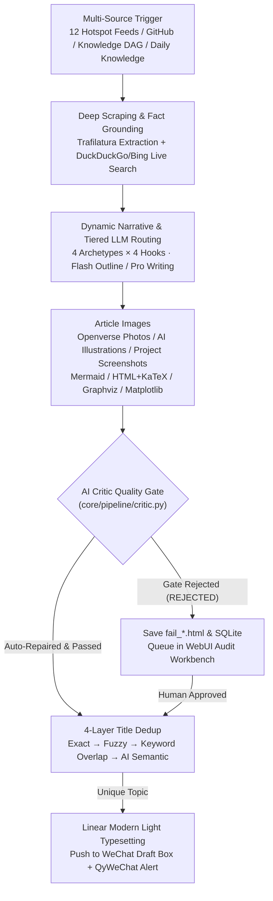

# AutoWeChat — Enterprise AI WeChat Official Account Creation & Compliant Publishing Workbench

<p align="center">
  <strong>Human-in-the-Loop Publishing</strong> · <strong>4 Automated Content Workflows</strong> · <strong>Web Fact Grounding & AI Critic Gate</strong> · <strong>Linear Modern Light Bilingual WebUI</strong>
</p>

<p align="center">
  <a href="README.md">简体中文</a> ·
  <a href="#core-workflows">Core Workflows</a> ·
  <a href="#architecture--quality-loop">Architecture</a> ·
  <a href="#webui-5-stage-console">WebUI Console</a> ·
  <a href="#quick-start">Quick Start</a> ·
  <a href="DEVELOPMENT.md">Development Guide</a>
</p>

---

**AutoWeChat** is an end-to-end AI content production and operations workbench built for tech media, vertical creators, and professional WeChat Official Account teams. It automates the entire lifecycle from **multi-source / knowledge-graph discovery → full-text scraping & live fact grounding → dynamic narrative drafting → credited photography & technical diagram rendering → AI Critic quality gate & human audit → 4-layer deduplicated WeChat Draft Box publishing**.

> [!IMPORTANT]
> **Compliance & Safety Principle**: Every automated task only pushes articles to the WeChat Official Account **Draft Box**, paired with an interactive **Audit Workbench** for final human-in-the-loop review before publication.

---

## Table of Contents

- [Core Workflows](#core-workflows)
- [Architecture & Quality Loop](#architecture--quality-loop)
- [Key Engineering Capabilities](#key-engineering-capabilities)
- [WebUI 5-Stage Console](#webui-5-stage-console)
- [Project Structure](#project-structure)
- [Quick Start](#quick-start)
- [Environment Variables](#environment-variables)
- [Cloud Deployment & Scheduling](#cloud-deployment--scheduling)
- [Testing & Companion Docs](#testing--companion-docs)

---

## Core Workflows

Driven by a unified engine ([`core/engine.py`](core/engine.py) & [`main.py`](main.py)), AutoWeChat supports CLI execution, APScheduler cron jobs, and one-click WebUI dispatch across 4 specialized workflows:

| Task ID (`--task`) | Console Tab | Use Case | Core Mechanism |
| :--- | :--- | :--- | :--- |
| **`hotspots`** | Trending Hotspots | Tech, finance & current affairs commentary | 12 news sources + domain keyword filtering + `trafilatura` extraction + DuckDuckGo/Bing live fact grounding + 4 dynamic narrative archetypes |
| **`github`** | GitHub Open Source | Trending & high-potential OSS deep dives | GitHub Trending & API collector (optional `GITHUB_TOKEN`) + repository technical analysis + automated diagram/illustration rendering |
| **`aikepu`** | Science & Knowledge | Structured long-form series from knowledge trees | DAG-ordered unlocking across 5 built-in domain packs; Outline → Flash prompt optimization → up to 4 parallel `ThreadPoolExecutor` Sub-Agent workers |
| **`daily_knowledge`** | Daily Knowledge | Lightweight daily encyclopedia & bite-sized insights | Standalone [`daily_knowledge/`](daily_knowledge) engine with topic planning, historical deduplicator, and SQLite tracking |

---

## Architecture & Quality Loop



---

## Key Engineering Capabilities

### 1. Live Fact Grounding & Dynamic Narrative Engine
- **Full-Text Extraction & Fact Search**: [`core/hotspots/scraper.py`](core/hotspots/scraper.py) extracts primary article bodies using `trafilatura` with browser-header HTTP fallback; [`core/hotspots/searcher.py`](core/hotspots/searcher.py) queries DuckDuckGo (HTML/Lite) and Bing HTML search when `ENABLE_FACT_SEARCH=True` (default up to `MAX_FACT_SNIPPETS=4`) to ground articles in verifiable facts.
- **Anti-Cliche Narrative Diversity**: [`core/hotspots/narrative.py`](core/hotspots/narrative.py) pairs 4 structural archetypes (`investigative_game`, `tech_deep_dive`, `business_war`, `narrative_human`) with 4 opening hooks (`counter_intuitive`, `cost_and_bill`, `critical_scene`, `cognitive_reversal`) to avoid repetitive AI prose.

### 2. AI Critic Quality Gate & HITL Audit Workbench
- **Pre-Publish Evaluation & Auto-Repair**: [`core/pipeline/critic.py`](core/pipeline/critic.py) flags stock phrases, trims redundant paragraph openings and promotes existing section labels to H2, enforces length and title punctuation rules, and scores drafts. Rejected articles are saved as `data/previews/fail_*.html` and persisted in [`data/auto_publish.sqlite`](core/db/manager.py) (SQLite WAL mode) with status `REJECTED`.
- **Human-in-the-Loop Approval**: Editors inspect full rendered HTML previews in the WebUI `Audit` tab and trigger `/api/review/approve` to push approved drafts directly to WeChat.

### 3. Credited Photos, Project Screenshots and Technical Diagrams

- Hotspot articles and Daily Knowledge search Openverse for the physical subject in each illustration slot. For example, `【此处插入配图：rooftop solar panels】` searches for rooftop solar panels. Captions include the work title, creator, license and original page. Resizing preserves the full frame and watermark.
- If a slot has no suitable photo, Qwen or an enabled local Stable Diffusion service generates an illustration captioned “AI 示意图”. Covers prefer available photos. When an AI illustration becomes the cover, the label is embedded in the image. If generation also fails, the slot is omitted and a branded card can serve as the cover. GitHub articles prefer project images and screenshots. Educational series use their fixed cover and diagrams.
- **Parallel Diagram & Formula Rendering (`utils/diagram_gen.py`)**: Renders up to `DIAGRAM_PARALLEL_WORKERS=5` charts concurrently with WeChat-safe opaque white backgrounds:
  - **High-Fidelity**: `Mermaid` (`mermaid.ink` API with local [`utils/html_render.py`](utils/html_render.py) Selenium fallback) and `HTML + Tailwind + KaTeX` dashboards/formulas.
  - **Lite Fallbacks**: `Graphviz DOT` ([`utils/lite_render.py`](utils/lite_render.py)) and `Matplotlib` structured cards (formula, comparison, and summary cards) unified under the Linear Modern Light palette (`#FFFFFF`, `#F8F9FB`, `#4F5BD5`).

### 4. Four-Layer WeChat Title Deduplication (`core/shared/publisher.py`)
Fetches active WeChat Cloud Drafts, published titles, and local history, running 4 progressive checks:
1. Normalized **exact string match**
2. **Character-level fuzzy similarity** (`rapidfuzz` / `SequenceMatcher`)
3. **Keyword n-gram overlap** (`>= 0.70`)
4. **DeepSeek AI semantic deduplication** fallback

### 5. 5 Vertical Knowledge Packs & Zero-Interview Customization (`tools/`)
- **Built-in Domain Graphs**: [`data/knowledge_trees/`](data/knowledge_trees) includes `aikepu.json` (30 nodes), `career.json` (10), `health.json` (8), `law.json` (10), and `tax.json` (6), paired with domain prompts in [`prompts/`](prompts) (`law_skill.md`, `tax_skill.md`, etc.).
- **Automated Account Cloning**: [`tools/analyze_account.py`](tools/analyze_account.py) extracts writing style into custom skill prompts, and [`tools/build_knowledge_tree.py`](tools/build_knowledge_tree.py) builds and activates new vertical DAG trees.

### 6. Multi-Key Rotation Pool & Prompt Cache Telemetry
- [`utils/key_pool.py`](utils/key_pool.py) parses comma-separated keys in `LLM_API_KEYS` and `DASHSCOPE_API_KEYS` for thread-safe round-robin rotation and error cooldowns (120s for 429 rate limits, 300s for auth errors).
- [`core/shared/llm.py`](core/shared/llm.py) routes Flash vs. Pro models by task complexity and reports Prompt Cache hit rates, saved tokens, and CNY cost savings live in the UI.

---

## WebUI 5-Stage Console

Built as a zero-build native ES Module SPA ([`static/js/main.js`](static/js/main.js)) with a 3-sheet CSS token architecture ([`tokens.css`](static/css/tokens.css), [`components.css`](static/css/components.css), [`views.css`](static/css/views.css)) and a 4-layer CSS `.ambient-canvas`, the **Linear Modern Light** WebUI delivers responsive desktop + mobile bottom-dock navigation, instant ZH/EN switching, and optional `WEBUI_TOKEN` login protection ([`templates/login.html`](templates/login.html)).

| View ID | Name | Capabilities |
| :--- | :--- | :--- |
| **`console`** | Console | 4-workflow tabs, Start/Pause/Resume/Stop, Preheat Cache, Prompt Cache telemetry strip, 4-phase pipeline stepper, Timeline Accordion vs. Raw logs, Knowledge Graph card & Live Pulse |
| **`graph`** | Knowledge Graph | Interactive DAG explorer, Tier 1–4 filters, vertical pack switcher, custom JSON import, WeChat published sync, node inspector drawer (`Generate Now`, mark published/draft/reset) |
| **`audit`** | Audit Workbench | HITL quality gate queue (`All / Pending / Approved / Drafted / Published`), HTML article preview modal, direct draft push (`/api/review/approve`), batch delete |
| **`image`** | Image Studio | WeChat article URL scraping & compliant redraw (`Qwen-Image-3.0-Pro`), Markdown prompt extraction, HTML5 drag-and-drop upload, 1:1 mobile WeChat preview |
| **`ops`** | Ops & Settings | 3 sub-tabs: **Sources** (12-feed health matrix & probe), **Schedule** (APScheduler cron config for 4 workflows), **Settings** (hot-reload WeChat, LLM, DashScope, SD & concurrency settings) |

---

## Project Structure

```text
wechat_auto_publish/
├── main.py                        # Headless CLI entrypoint (--task hotspots|github|aikepu|daily_knowledge)
├── webui.py                       # Flask + SSE WebUI console & REST API server
├── config.py                      # Central environment settings & verified defaults
├── run.bat / run_gui.bat          # Windows quick-launch scripts for WebUI
├── Dockerfile / docker-compose*.yml / render.yaml  # Container & cloud deployment manifests
│
├── core/
│   ├── engine.py                  # Unified workflow dispatcher
│   ├── db/                        # SQLAlchemy models & SQLite WAL audit DB (data/auto_publish.sqlite)
│   ├── pipeline/                  # PipelineEngine, node contracts & AI Critic gate (critic.py)
│   ├── hotspots/                  # Hotspot processor, Trafilatura scraper, DuckDuckGo/Bing searcher, narrative engine
│   ├── github/                    # GitHub Trending / API collector & OSS deep-dive workflow
│   ├── aikepu/                    # Knowledge DAG parser, outline/prompt optimizer & parallel Sub-Agent processor
│   ├── plugins/                   # Source abstractions for 12 news feeds & GitHub
│   └── shared/                    # Tiered LLM router, Linear Light WeChat typesetting & 4-layer dedup publisher
│
├── daily_knowledge/               # Standalone Daily Knowledge workflow, deduplicator & SQLite store
├── tools/                         # Zero-interview style analyzer & knowledge tree builder scripts
├── prompts/                       # Task & vertical domain writing skill prompts
├── utils/                         # AI image handler, 5-mode diagram generator, key pool, HTTP & spider helpers
├── templates/ & static/           # Linear Modern Light zero-build ES Module frontend
├── data/                          # Knowledge trees, caches, fail_*.html previews & SQLite DB
├── tests/                         # 13 Pytest unit, integration & WebUI interaction test suites
└── docs/                          # Design specs & implementation plans
```

---

## Quick Start

### 1. Prerequisites
- **Python 3.11+** & **Git**
- **Optional**: Chrome/Chromium (with Selenium/Playwright) for local `HTML+KaTeX` / `Mermaid` rendering and GitHub scraping fallback; system `Graphviz` (`dot`) for lightweight DOT diagrams.

### 2. Installation

```bash
git clone https://github.com/Chain813/wechat-automatic-publisher.git
cd wechat-automatic-publisher
pip install -r requirements.txt
cp .env.example .env
```

Set your **LLM API key** and **WeChat app ID and secret** in `.env`. Openverse supports anonymous photo search. Set a **DashScope key** to use Qwen for fallback illustrations and AI redraw in Image Studio.

> [!NOTE]
> **WeChat IP Whitelist**: Add your server or local machine's public egress IP to the **API IP Whitelist** in the WeChat Official Account admin panel before pushing drafts.

### 3. Running AutoWeChat

```bash
# Option A: WebUI Console (auto-binds port 5001, falling back to 5002/5050/8080/8888)
python webui.py

# Option B: Headless CLI Workflows
python main.py --task hotspots
python main.py --task github
python main.py --task aikepu
python main.py --task daily_knowledge

# Option C: Zero-Interview Customization Tools
python tools/analyze_account.py
python tools/build_knowledge_tree.py
```

---

## Environment Variables

All settings are defined in [`config.py`](config.py):

| Variable | Description | Code Default |
| :--- | :--- | :--- |
| `WECHAT_APP_ID` / `WECHAT_APP_SECRET` | WeChat Official Account credentials | `""` |
| `LLM_API_KEY` / `LLM_API_KEYS` | Single LLM key or comma-separated pool for automatic rotation | `""` |
| `LLM_BASE_URL` | OpenAI-compatible API endpoint | `https://api.deepseek.com` |
| `LLM_MODEL` | Default LLM model | `deepseek-v4-flash` |
| `LLM_TEMPERATURE` / `LLM_MAX_TOKENS` | Sampling temperature & max token budget | `0.75` / `8192` |
| `DASHSCOPE_API_KEY` / `DASHSCOPE_API_KEYS` | Single DashScope key or comma-separated rotation pool | `""` |
| `IMAGE_GEN_MODEL` / `QWEN_IMAGE_MODEL` | Default AI image generation model | `qwen-image-3.0` |
| `QWEN_IMAGE_REDRAW_MODEL` | Image Studio redraw model | `qwen-image-3.0-pro` |
| `QWEN_VL_MODEL` | Vision-language analysis model | `qwen-vl-max` |
| `SD_ENABLED` / `SD_API_URL` | Local Stable Diffusion WebUI fallback toggle & URL | `True` / `http://127.0.0.1:7860` |
| `DIAGRAM_PARALLEL_WORKERS` | Concurrent technical diagram rendering threads | `5` |
| `ENABLE_FACT_SEARCH` / `MAX_FACT_SNIPPETS` | Live web fact grounding toggle & snippet limit | `True` / `4` |
| `HOTSPOT_CACHE_TTL_SECONDS` | Hotspot source cache TTL (seconds) | `60` |
| `MAX_TOPICS_PER_RUN` / `MAX_AIKEPU_PER_RUN` | Max generated articles per run | `3` / `1` |
| `KNOWLEDGE_TREE` | Default tree pack (`_active.txt` takes precedence if present) | `aikepu` |
| `GITHUB_TOKEN` | Optional GitHub token for higher API rate limits | `""` |
| `QYWECHAT_WEBHOOK` | Enterprise WeChat group alert webhook URL | `""` |
| `BRAND_NAME` / `ARTICLE_AUTHOR` | Official account name and byline (a blank byline uses the account name) | `极研JiYan` |
| `WEBUI_TOKEN` | Optional WebUI access password/token | `""` |
| `CLOUD_MODE` | Stateless cloud guard (`"1"` enables cloud-first sync to avoid local overwrite) | `""` (`False`) |

---

## Cloud Deployment & Scheduling

- **GitHub Actions**: [`.github/workflows/trigger.yml`](.github/workflows/trigger.yml) supports scheduled cron runs and manual `workflow_dispatch` task selection.
- **Docker Compose**: Run `docker compose up -d --build` to launch the containerized WebUI with headless Chromium, Chinese fonts, and persistent `./data` & `./.env` mounts.
- **Render**: [`render.yaml`](render.yaml) provides a starter blueprint with `CLOUD_MODE` and generated `WEBUI_TOKEN`; verify that your Render dashboard defines `DASHSCOPE_API_KEY`, `LLM_API_KEY`, and `WECHAT_*` matching `.env.example`.

---

## Testing & Companion Docs

```bash
# Core unit & API integration suite
python -m pytest tests/ -q --ignore=tests/test_webui_e2e_interactions.py

# Full suite including Playwright browser E2E tests
python -m pytest tests/ -q
```

- [README.md](README.md) — Simplified Chinese Documentation
- [DEVELOPMENT.md](DEVELOPMENT.md) — Architecture & Contributor Guide
- [CLAUDE.md](CLAUDE.md) — AI Engineering Rules & Conventions
- [CHANGELOG.md](CHANGELOG.md) — Release History & Unreleased Changes
- [GLOSSARY.md](GLOSSARY.md) / [GLOSSARY_EN.md](GLOSSARY_EN.md) — Project Glossary

---

## Disclaimer

This project is intended for research, productivity enhancement, and compliant assisted publishing. Always review drafts in the **Audit Workbench** prior to publication and comply with WeChat Official Account platform guidelines and local regulations.
